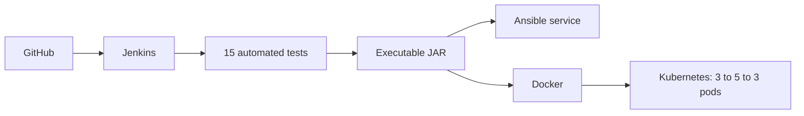

# Unit Converter API

A small Java service for converting everyday measurements, built for the DevOps self-learning assignment.

**Student:** Syed Shaibaan Hussain

**USN:** 1MS24CY056

Java 17 and Maven are required. Build with `mvn clean package`, then run `java -jar target/unit-converter.jar`.

The project uses three GET routes. There is no database or frontend.

| Request | Result |
| --- | --- |
| `/temperature?celsius=25` | 77 degrees Fahrenheit |
| `/distance?kilometres=5` | 3.1069 miles |
| `/health` | `{"status":"UP"}` |

Conversion responses include the input, input unit, result and output unit. Results are rounded to four decimal places. Inputs must be finite numbers within +/- 1 billion; distance must also be non-negative. Missing, malformed and out-of-range inputs return HTTP 400.

```bash
mvn clean package
java -jar target/unit-converter.jar
curl 'http://localhost:8080/temperature?celsius=25'
curl 'http://localhost:8080/distance?kilometres=5'
```

The DevOps workflow is:



- `Jenkinsfile`: SCM polling, Test stage, Build stage, JUnit results and archived JAR.
- `ansible/`: Ubuntu service setup with a role, configurable port and restart handler.
- `Dockerfile`: Java runtime image running as a non-root user.
- `k8s/`: namespace, three-replica Deployment, Service, ConfigMap and health probes.
- `scripts/`: deployment and scaling commands.
- `docs/setup.md`: complete setup and demonstration steps.
- `evidences/`: this project's screenshots and original execution logs.
- [`reports/DevOps_Report_Syed_Shaibaan_Hussain.pdf`](reports/DevOps_Report_Syed_Shaibaan_Hussain.pdf): college-format report, with editable LaTeX in `reports/overleaf/`.

Both `main` and `feature/unit-conversions` are retained to show the merge workflow. The CI enhancement is automated testing; the deployment enhancements are health probes and external configuration through a ConfigMap.

This is a local classroom demo. Run Ansible and Kubernetes from Ubuntu or WSL with systemd and Docker available. No paid cloud account is required.

